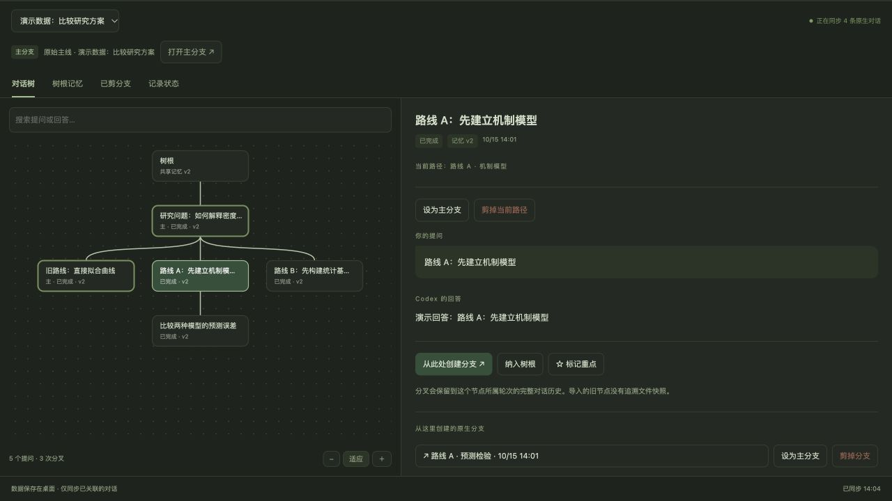

# 对话树 · Codex Conversation Tree

把 Codex 的长对话整理成一棵可以分叉的思考树，保留探索路线和共同结论。

**macOS 本机测试版 · v0.4.4 · 数据保存在本机**

适合需要反复尝试方案的开发者、研究者，以及经常进行长对话的 Codex 用户。

## 下载与安装

1. [下载 macOS 安装包](https://github.com/TR-UE/codex-conversation-tree/releases/download/v0.4.4/codex-conversation-tree-0.4.4-macOS.zip)，解压后双击 `安装.command`。
2. 重启支持本地插件的 Codex / ChatGPT 桌面应用，在插件目录的“我的本地工具”中找到并启用“对话树”。如果已有个人插件目录，请在该目录中查找。
3. 在一个本机对话中通过 `@` 选择“对话树”，发送：**打开对话树面板并记录当前对话。**

只想查看已有记录时，发送：**查看已经记录的对话树。**

版本说明与安装包校验文件见 [v0.4.4 发布页](https://github.com/TR-UE/codex-conversation-tree/releases/tag/v0.4.4)。

需要已登录的桌面应用、本机 Codex CLI 和 Node.js 22 或以上；安装器优先寻找应用内置的运行环境。读取压缩的原生历史需要 Node.js 24。macOS 已验证；其他平台尚未验证。

## 可以做什么

- **查看对话路径**：已关联对话的提问和可见回答会自动形成节点。
- **从历史节点分叉**：从已完成的真实轮次创建一条原生 Codex 分支，打开同一个分支继续提问。
- **选择主分支**：把当前采用的路线设为主分支，保留其他探索路线。
- **剪枝与恢复**：隐藏不再需要的路线并暂停同步，之后可以恢复。剪掉旧主线会保留新主分支及其下游、共有历史和树根记忆。
- **维护树根记忆**：由用户选择需要跨分支保留的目标、规则和结论，保存版本及来源节点。
- **按需删除原生分支**：在面板预览具体范围并手动确认后，通过原生接口删除。删除后的原生会话不能恢复，已有本地记录仍保留。

## 演示



截图使用独立演示数据，不包含真实用户聊天。原生对话继续在 Codex 中进行；面板负责查看路径、创建分支和维护记忆。

一个典型流程：提出研究问题 → 从同一节点尝试两条路线 → 选择一条主分支 → 把有效结论纳入树根 → 剪掉暂时不用的路线。

## 数据与隐私

- 默认保存位置：`~/Desktop/Codex-Conversation-Tree/data/native/`。
- 只同步用户显式关联的本机对话，不自动导入所有聊天。
- 保存用户文本和可见回答，不保存系统提示、隐藏推理或工具调用参数。
- 插件的记录与面板不上传聊天；原生 Codex 对话仍按宿主自身的设置运行。
- 安装包与本仓库不包含任何用户的聊天、树根记忆或登录凭据。

## 当前边界

- 历史分叉继承该轮次之前的对话。导入旧节点时没有当时的文件快照，不提供完整文件或外部应用状态回滚。
- 同一轮次内的追加提问会分别记录，但只允许在该轮次完成后的最后一个提问处分叉。
- 原始会话仍是原生历史来源，本版只支持剪枝，不支持永久删除它。包含当前主分支的路径也不能整支永久删除。
- 二进制附件的完整归档尚未实现。
- 当前已验证的是 Codex 内置浏览器面板；原生 MCP Apps 视图的宿主渲染仍待单独验证。
- 自动记录不依赖 hooks，分发包不包含实验性 hooks。
- 本项目是独立开发的本地插件，尚未发布到 OpenAI 公共插件目录。

## 更新

下载新的安装包，再运行其中的 `安装.command`，然后重启应用。安装器保留已有本地数据和个人目录中的其他插件条目。

## 开发与验证

插件源码位于 `plugin/codex-conversation-tree/`。无需安装第三方 npm 依赖。

```sh
npm test
python3 scripts/package-plugin.py
node tests/install-smoke.mjs dist/codex-conversation-tree-0.4.4-macOS.zip
```

33 项单元测试覆盖历史节点导入、分支共享、主分支切换、剪枝恢复、记忆保留及原生删除范围检查。安装与原生接口验证使用独立临时配置，不操作用户现有聊天。

有本机 Codex CLI 时，可以运行 `node tests/native-history-delete-smoke.mjs`。该测试使用本机的确定性模型服务生成真实历史，不请求 OpenAI 模型服务。它验证创建一条分支、在同一 ID 上继续提问、自动记录以及原生删除的依赖检查。

详见 [版本说明](CHANGELOG.md)、[安装与故障排查](docs/INSTALL.md) 和 [验证记录](docs/verification.json)。

## 反馈

请通过本仓库 Issues 提交安装或使用问题，提供操作步骤、期望结果、实际结果和版本号。提交前请移除聊天正文、账号凭据、服务器地址等私人信息。

License：暂未指定。
